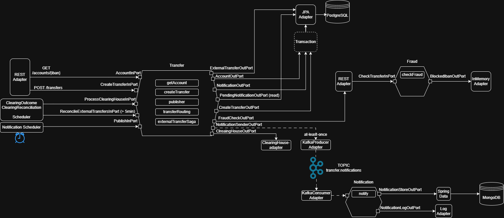

# agentic-bank

Banking microservices with **hexagonal architecture**, built with AI agents
(planner, tester, implementer, reviewer): tests first, implementation, last review.



## The services

| Service | Role | Data | Port |
|---|---|---|---|
| `transfer-service` | accounts and transfers (internal and external) | PostgreSQL | 8080 |
| `fraud-service` | return the response on fraud check (> 10000 EUR, blocked IBANs) | in memory | 8081 |
| `notification-service` | receive the outcome from the transfer, logs and save | MongoDB | none (Kafka consumer) |

Transfer invoke the Fraud through HTTP (sync) and notify the Notification through Kafka (async).
Every service has its own DB, and the services talk to each other only through contracts defined in **docs/contracts/**.

## Runs the projects

It runs on **Java 21** and **Docker**.

**1. Infrastructure**: PostgreSQL (5433 port), Kafka (9092, with topic already created)
and MongoDB (27018).

```
docker compose up -d
```

**2. Compile the services**, skipping tests:

```
cd fraud-service
.\mvnw.cmd -DskipTests package
cd ..\notification-service
.\mvnw.cmd -DskipTests package
cd ..\transfer-service
.\mvnw.cmd -DskipTests package
cd ..
```

**3. Start them**, from ide or terminal, in that order:

```
java -jar fraud-service/fraud-bootstrap/target/fraud-bootstrap-0.0.1-SNAPSHOT.jar
java -jar notification-service/notification-bootstrap/target/notification-bootstrap-0.0.1-SNAPSHOT.jar
java -jar transfer-service/transfer-bootstrap/target/transfer-bootstrap-0.0.1-SNAPSHOT.jar
```

To enable notifications and external transfers, first of all you have to enable 2 properties setted false as default. 
Run configuration with Environment variables or in PowerShell:

```
$env:NOTIFICATION_PUBLISHER_ENABLED = 'true'   # Transfer publish notifications on kafka
$env:CLEARING_OUTCOMES_ENABLED = 'true'        # external transfer gets reconciled
```

**4. Try it** (with Postman otherwise `curl`; In PowerShell, save the JSON body in a file and use curl.exe -X POST ... --data-binary '@body.json'):

```
# transfer between 2 IBANs 
curl -X POST localhost:8080/transfers -H "Content-Type: application/json" \
  -d '{"sourceIban":"IT60X0542811101000000000001","destIban":"IT60X0542811101000000000002","amount":10.00,"currency":"EUR"}'

# external transfer (different ABI): returns 202 with status SENT
curl -X POST localhost:8080/transfers -H "Content-Type: application/json" \
  -d '{"sourceIban":"IT60X0542811101000000000002","destIban":"IT60X0306909606100000012345","amount":5.00,"currency":"EUR"}'

curl localhost:8080/transfers/<transferId>                        # transfer status
curl "localhost:8080/transfers?iban=IT60X0542811101000000000001"  # all transfers for an IBAN
curl localhost:8080/accounts/IT60X0542811101000000000001          # balance for an Account
```

**Test**: `.\mvnw.cmd test`. With
`docker compose up -d` will be run also the tests on PostgreSQL, Kafka e MongoDB.

**Stop it:** `docker compose down` (add `-v` to delete data).

## Technical chooses

**Hexagonal architecture.** Every service is organized in modules: `domain` (Java, no framework),
`application` (use cases and ports), an `adapter` for each technology or system (`postgres`,
`kafka`, `fraud`, ...) and `bootstrap` (Spring Boot and configuration). The **in ports** are what the service offer to the external, **out ports** are what it
asks from the external; adapters implement them or invoke them, but never each other. In this way the business logic does not rely on implementations.

**Domain.** They are immutable objects. Amounts are `BigDecimal`.

**Outbox: notify with no worries to lose any message.** There is no way to put in same transaction PostgreSQL and Kafka. 
In the same transaction the transfer service writes into the DB the new transfer, and the new `outbox`; a scheduler invoke the kafkaProducer which send the outbox on transfer.notifications topic.
No notification can be lost, but it could be sent twice (*at-least-once*): Notification is idempotent, it saves with `transferId` as `_id`.

**External transfers with SAGA pattern.** An external transfer (to a different ABI from sender) can not rely on transaction between two banks, because it needs an external entity as bridge.
Charge and `SENT` status in local transaction, send to **clearing house** (no real implementation) outside the transaction:
- accepted: `COMPLETED`; rejected: **refund** and `REJECTED`;
- if the clearing house did not receive the instruction: refund;
- if its unknown (timeout): `UNKNOWN`, funds are retained, **no refunds**, and the reconciliation handles it.

The **reconciliation job** runs every 30 seconds asks for the stalled transfers (more than 5 mins) and it closes them.

**Possible transfer statuses:** `PENDING` (in memory only), `SENT`, `UNKNOWN`, `COMPLETED`, `REJECTED`. 200 is the response
if the transfer is final (internal or not allowed from fraudCheck), 202 for `SENT` o `UNKNOWN`.

**Sync or async.** the Fraud checker is an HTTP call outside the transaction (no answer -> no save). 
Notifications and clearing house are async.

## Environment variables

| Variable | Default | Role |
|---|---|---|
| `NOTIFICATION_PUBLISHER_ENABLED` | `false` | Transfer sends outbox to Kafka |
| `CLEARING_OUTCOMES_ENABLED` | `false` | turn on the scheduler for clearing house |
| `CLEARING_SIMULATOR_MODE` | `ACCEPT` | clearing house behaviour: `ACCEPT`, `REJECT`, `UNAVAILABLE`, `TIMEOUT_THEN_ACCEPT`, `TIMEOUT_THEN_REJECT` |
| `TRANSFER_BANK_CODE` | `05428` | Internal bank ABI: ABI != external transfer |
| `TRANSFER_DEMO_DATA_ENABLED` | `true` | load demo data on startup |
| `TRANSFER_DB_PASSWORD`, `NOTIFICATION_MONGO_PASSWORD` | `transfer_dev`, `notification_dev` | develop password |

## Known limits

- **No authentication/authorization**.
- **Clearing house is simulated** and stores the outcomes in memory.

## More

- [`CLAUDE.md`](CLAUDE.md): project rules; each service has its own `CLAUDE.md`.
- [`docs/contracts/`](docs/contracts/): services contracts.
- [`docs/plans/`](docs/plans/): plans for every step.
